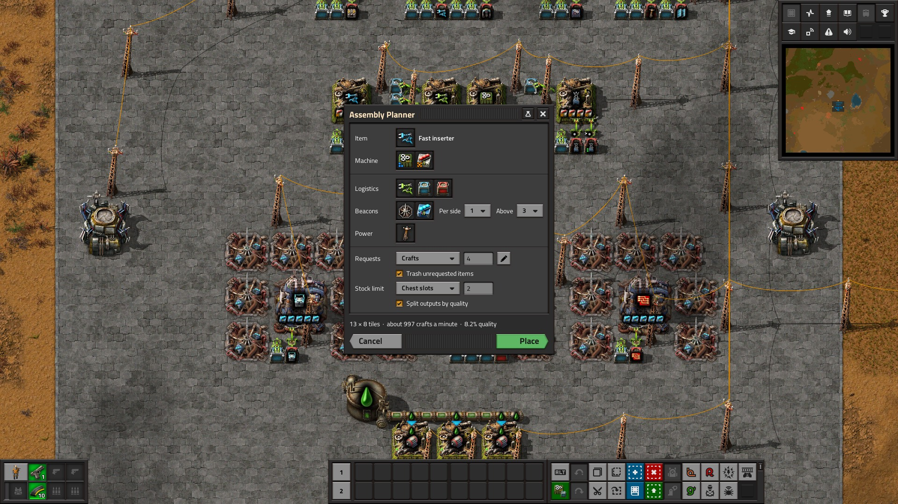
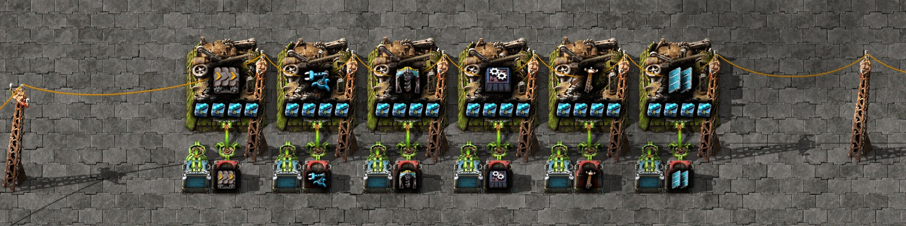
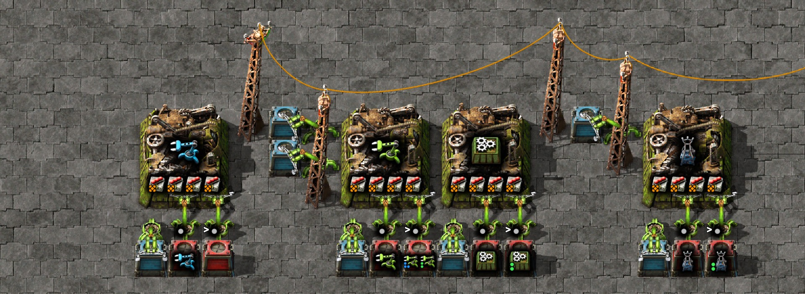
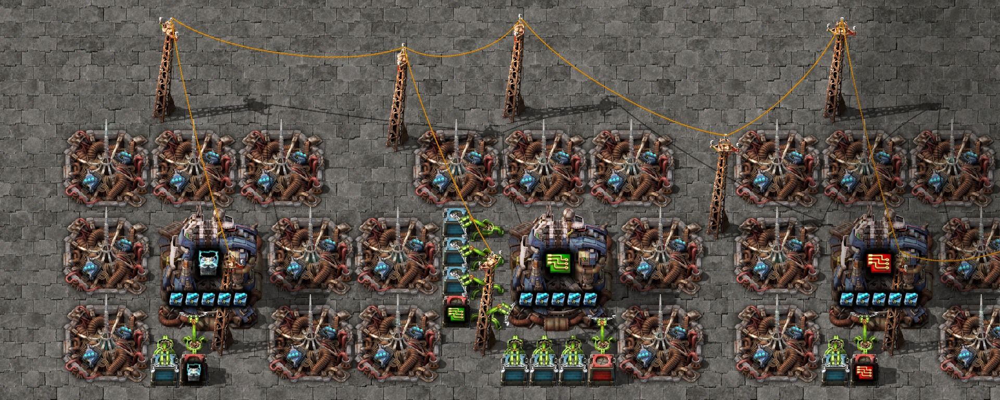
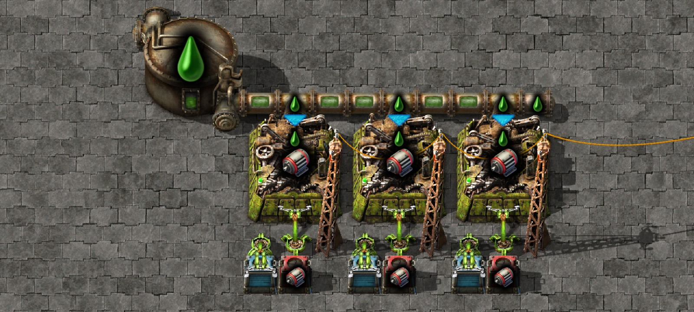

# Assembly Planner

**Pick an item and get a ready-made bot mall blueprint for it.**

Tell the planner what you want to make, and it lays out the machine, a requester chest for the
ingredients and an output chest for what it makes. Change anything you like, then place it.

## What you can change

- The machine, modules, inserters, chests and electric pole, each at any quality
- How much to request: a few crafts' worth, a few minutes' worth, or your own amounts
- When to stop: when the chest is full, at a count across your logistic network, or never
- Beacons beside and above the machine
- Better-quality items get their own chest when the machine can make them

Recipes with a fluid get a pipe along the back, so blueprints placed side by side share one pipe.

## How to use it

1. Research **Logistic system**, the one that unlocks requester chests. A button appears in your
   shortcut bar, or press **Ctrl+Shift+A**.
2. Pick an item, change what you like, and press **Place**.
3. The blueprint is now in your hand. Rotate or flip it if you want, then build.

## Examples

A mall row, one item per machine:

With quality modules, normal items go to one chest and better ones to the other:

Electromagnetic plants with beacons:

Fluid recipes sharing one pipe:

## Good to know

- When one inserter can't keep up, the planner adds more, each with its own chest.
- Modded machines, chests, inserters, modules and beacons all work. Only researched ones are
  shown unless you turn on **Show unresearched items** with the flask button at the top of the
  planner.
- The network count only works inside roboport range.
- Not supported yet: recipes that make a fluid or need two fluids, and machines that burn fuel,
  like the biochamber.

## Requirements

Factorio 2.1. Space Age is not required.

## Check my other mods

- [Upcycler Planner](https://mods.factorio.com/mod/upcycler-planner) — Pick an item and a target quality, and get a ready-made upcycling loop blueprint.
- [Pure Modules](https://mods.factorio.com/mod/pure-modules-realk) — Stronger end-game tiers of modules with reduced penalties. They require a powerful new beacon to work. Optional Quality and Space Age support.
- [Quality Recycler](https://mods.factorio.com/mod/quality-recycler) — A new recycler with quality built right in.
- [Quality Assembler](https://mods.factorio.com/mod/quality-assembler) — A fast assembling machine with built-in quality.
- [Extra Qualities](https://mods.factorio.com/mod/extra-qualities) — Adds two new quality tiers above legendary: Mythic and Celestial. Also reworks vanilla quality progression so Space Age fits well with 6 quality tiers.
- [Robot World Continued (RealK)](https://mods.factorio.com/mod/robotworld-continued-realk) — Tune your robots and roboports, or get robots early. A Factorio 2.1 port of Robot World Continued.

## AI-Assisted Development

The development of this mod was done with help of AI coding assistants.

## License

GPLv3. See [LICENSE](https://github.com/RealK465/RealK_Factorio_Mods/blob/main/assembly-planner/LICENSE).
