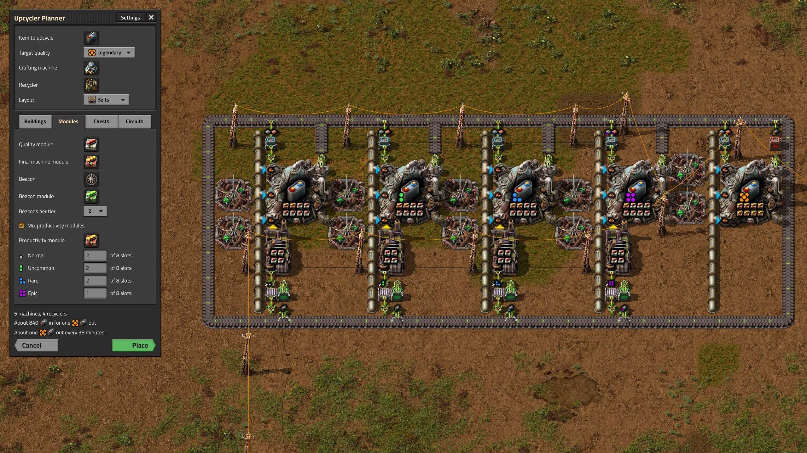
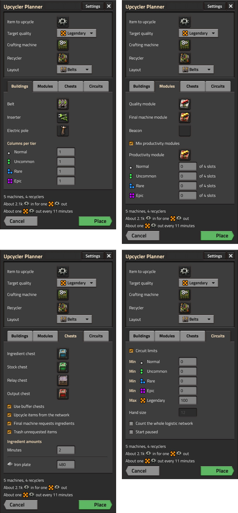

# Upcycler Planner

**Pick an item and a target quality, and get a ready-made upcycling loop blueprint.**

What [Mining Patch Planner](https://mods.factorio.com/mod/mining-patch-planner) does for mining outposts and [P.U.M.P.](https://mods.factorio.com/mod/pump) does for oil, this mod does for quality upcycling. It works with modded machines, recyclers, belts, modules and beacons too.

Plan a loop, place the blueprint, and watch it climb

## What you can change

- The layout: a belt ring, or a bot loop where your robots carry everything between tiers
- Every building in the loop, most of them at any quality
- More columns per tier, for more output from a bigger blueprint
- The module mix: the planner works out the best ratio of quality and productivity modules for you ([Quality Math](https://wiki.factorio.com/Tutorial:Quality_upcycling_math))
- Beacons, and pipes for recipes with a fluid
- Circuit limits: stop at a maximum and keep a minimum of each lower quality. The numbers sit on a combinator you can edit later.

A bot loop: no belts, robots carry everything between tiers

A loop with beacons and pipes

A loop built from modded machines and recyclers

## How to use it

1. Research **Recycling**, or whatever unlocks the recycler first in your mods. Then click this button in your shortcut bar, or press **Ctrl+U**:
   
2. Pick the item and the **Target quality**.
3. Pick a **Layout**, then change anything you like in the **Buildings**, **Modules**, **Chests** and **Circuits** tabs.
4. Press **Place**. The blueprint is now in your hand: move, rotate or flip it, then build.

The planner's four tabs

The bottom of the window shows how big the loop is and how fast it runs

## Good to know

- Only researched items are shown, unless you tick **Show unresearched items** in the planner's **Settings**.
- Not supported: recipes that need two fluids or give back a fluid (like the quantum processor), and items that recycle into themselves (like steel). **Belts** also can't loop a recipe with more than 10 ingredients.
- Items that spoil can be planned, but some may rot in the loop before they reach your target.
- Build the loop inside roboport range: your robots fill its chests and take the finished items away, and with **Bots** they carry everything.
- A **Bots** loop always upcycles what your network holds of the item, and sends finished items from its lower tiers to storage. Keep a storage chest in the network.
- Huge layouts with thousands of columns take seconds to plan, and even bigger ones can crash the game.

## Planned

- Lightning collectors on Fulgora
- Heating pipes on Aquilo
- Exporting the layout as a parametrised blueprint

## Requirements

Factorio 2.1 with **Space Age**.

## Credits

Inspired by kvdveer's [Upcyclers](https://forums.factorio.com/viewtopic.php?t=121438) blueprint book, and by two planners that showed how good this kind of mod can feel: rimbas' [Mining Patch Planner](https://mods.factorio.com/mod/mining-patch-planner) and Xcone's [P.U.M.P.](https://mods.factorio.com/mod/pump).

## Check my other mods

- [Pure Modules](https://mods.factorio.com/mod/pure-modules-realk) — Stronger end-game tiers of modules with reduced penalties. They require a powerful new beacon to work. Optional Quality and Space Age support.
- [Quality Recycler](https://mods.factorio.com/mod/quality-recycler) — A new recycler with quality built right in.
- [Quality Assembler](https://mods.factorio.com/mod/quality-assembler) — A fast assembling machine with built-in quality.
- [Extra Qualities](https://mods.factorio.com/mod/extra-qualities) — Adds two new quality tiers above legendary: Mythic and Celestial. Also reworks vanilla quality progression so Space Age fits well with 6 quality tiers.
- [Robot World Continued (RealK)](https://mods.factorio.com/mod/robotworld-continued-realk) — Tune your robots and roboports, or get robots early. A Factorio 2.1 port of Robot World Continued.
- [Assembly Planner](https://mods.factorio.com/mod/assembly-planner) — Pick an item and get a ready-made bot mall blueprint for it.

## AI-Assisted Development

The development of this mod was done with the help of AI coding assistants.

## License

GPLv3. See [LICENSE](https://github.com/RealK465/RealK_Factorio_Mods/blob/main/upcycler-planner/LICENSE).
